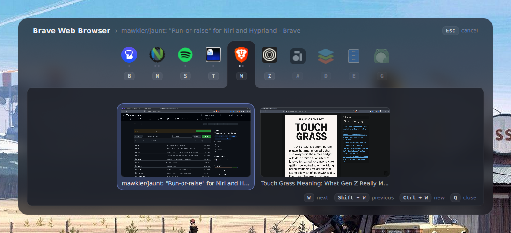

# Jaunt

The most efficient way to move between windows. For Hyprland.



## Usage

Jaunt works similarly to classic `Alt + Tab` switchers, but it is scoped to only one program's windows.

1. To switch to a window, press `Super + <key>`, where `<key>` is configured per program by you, for example:

    - `Super + t`: Terminal
    - `Super + w`: Web browser
    - `Super + s`: Spotify
    - etc...

2. Keep holding down the `Super` to see all windows of `<key>`'s program (if it's not running it gets launched)
3. Keep tapping `<key>` to cycle the focused window
4. Or press `Super + <number>` to go straight to a window, using the numbers shown beside them (windows 1-9, and only when the program has more than one)
5. Release `Super` to go to the currently selected window

Clicking anywhere outside the switcher closes it, which is the way out if a keybind ever isn't.

## Installation

### NixOS

```nix
# flake.nix
{
  inputs.jaunt.url = "github:mawkler/jaunt";
}
```

```nix
# ...then in your NixOS configuration:
{
  imports = [ inputs.jaunt.nixosModules.default ];

  services.jaunt = {
    enable = true;
    # If you prefer configuring with Nix (doesn't hot-reload)
    # settings = {
    #   keys.apps = {
    #     t = "ghostty";
    #     w = { cmd = "brave"; app_id = "brave-browser"; };
    #   }
    #   # ...
    # };
  };
}
```

This runs the daemon as a user service, which needs the session in systemd, e.g. `programs.hyprland.withUWSM = true`. Without `settings` it reads `~/.config/jaunt/config.toml` (which supports hot-reloading). See [Configuration](#configuration) for mor info.

### Other Linux distros

1. Install Jaunt:

    ```sh
    git clone https://github.com/mawkler/jaunt
    cargo install --path jaunt
    ```

2. Add this to your `~/.config/hypr/hyprland.lua`:

```lua
hl.on("hyprland.start", function() hl.exec_cmd("jaunt daemon") end)
```

## Configuration

Configuration is in `~/.config/jaunt/config.toml`, and it hot-reloads Jaunt on save.

A setting Jaunt can't make sense of never stops it: at startup it says what's wrong and that section falls back to its defaults, so the rest of your configuration still applies. On a reload it keeps the configuration it is already running instead, since a file being saved is a file half-written.

`jaunt default-config` prints a commented file with every setting at its default ([`default-config.toml`](src/config/default-config.toml)), and `jaunt default-config --write` puts it at `~/.config/jaunt/config.toml`, as long as there isn't one there already.

Example configuration:

```toml
[keys]
next = "Tab"             # only bound while the switcher is open; Super is implied
previous = "Shift + Tab"
cancel = "Escape"
close = "q"              # close the highlighted window; unset by default

[keys.apps] # Super + key
t = "ghostty"
s = "spotify"
w = { cmd = "brave", app_id = "brave-browser" } # when the window class isn't the command
"Shift + a" = "teams"                           # a key may carry modifiers, but then has no Shift to go back with

[switcher]
delay = 90                # milliseconds Super is held before the switcher appears
width = "50%"             # of the screen, or pixels
max_height = "40%"        # previews shrink to fit
icons = true              # icons rather than initials
background_opacity = 0.92 # the panel
foreground_opacity = 1    # the sheet holding the windows
theme = "default"
numbers = { action = "select" } # or "switch": a number key goes to its window at once

[previews]
enabled = true
height = 150   # pixels

[names] # by window class; otherwise the desktop entry's name
brave-browser = "Brave"
```

While the switcher is up, Jaunt puts Hyprland in a `jaunt` submap, so the keys it takes are its
own: `Super + 1` picks a window instead of switching workspace, and your `close` key closes the
highlighted window rather than the focused one. Everything you've bound comes back the moment the
switcher closes, and `Escape` always gets out.

That needs the Lua configuration. With the legacy parser, Jaunt can't claim the keys, so give any
of your own binds that clash with it a guard instead:

```lua
hl.bind("SUPER + Q", function()
    if #hl.get_layers({ namespace = "jaunt" }) == 0 then
        hl.dispatch(hl.dsp.window.close())
    end
end)
```

To blur what shows through the panel, add a layer rule:

```lua
hl.layer_rule({ match = { namespace = "^jaunt$" }, blur = true, ignore_alpha = 0.1 })
```

`ignore_alpha` keeps the corners outside the rounded panel sharp, and has to stay below
`background_opacity`, or nothing is blurred.

### Themes

There are multiple built-in themes, including `default`, `light`, `catppuccin`, `nord`, `one-dark` and `tokyo-night`, which live in [`themes/`](themes).

To create your own, put it in `~/.config/jaunt/themes/<name>.toml`, and set `theme = "<name>"` (or a path) in your config. Themes also support hot-reloading.

```toml
background = "#15171c" # the panel
surface = "#20232b"    # the sheet and its tab
accent = "#6b8cff"     # the selected window
text = "#c4cad8"       # window titles and keys
bright = "#eef1f7"     # the heading and the selected window's title
muted = "#78819a"      # secondary text and hints
```

## Development

To set up the development environment (requires [Nix](https://nixos.org/download/)), run

```sh
nix develop
```

The switcher's QML in `shell/` is built into the binary. `JAUNT_SHELL=$PWD/shell jaunt daemon` runs it from the checkout instead, reloading on every save.

## AI disclosure

This project started out as hand-chiseled. I have since pivoted to relying heavily on agentic LLMs.
